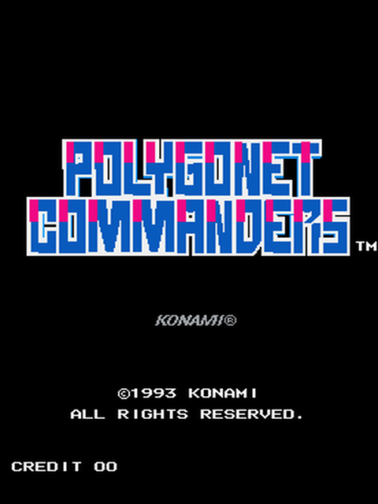
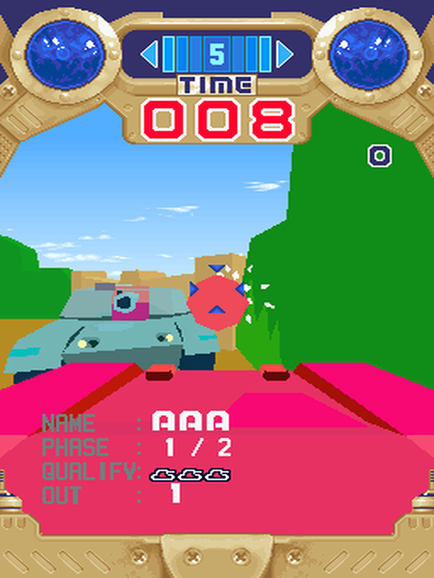
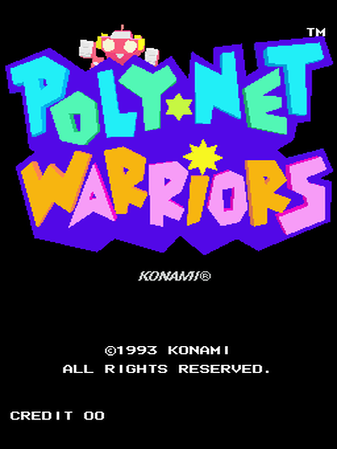
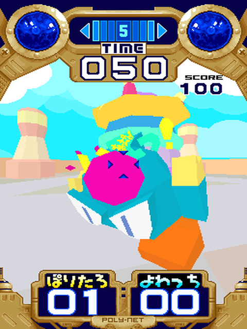

# Konami Polygonet for MiSTer

A MiSTer FPGA core for Konami's Polygonet board (GX305, 1993), Konami's first 3D arcade hardware, the board of MAME's
`konami/plygonet.cpp` driver. It runs **Polygonet Commanders** (`plygonet`), a tank battle played with two levers, and
**Poly-Net Warriors** (`polynetw`): a 68EC020 at 16 MHz, a DSP56156 at 40 MHz that does the 3D maths, two polygon renderer
pairs (K054009/K054010) with their framebuffers, a K053936 background, a text plane, and a Z80 with a K054539 for the sound.
Written from MAME 0.289's driver and its DSP56156 core, with MAME as the reference; the platform layer, the SDRAM controller and
the sound chips come from the mystwarr-mister core.

  <b>Polygonet Commanders</b> 
  
  

  <b>Poly-Net Warriors</b> 
  
  

The pictures are from MAME 0.289.

No ROMs are in this repository; you supply your own MAME sets.

**Status.** Both games are supported, tested and working on a real MiSTer. Built with Quartus 17.0, timing met on every clock
(the setup slack on the worst path; hold is met too, by +0.243 ns and +0.249 ns):

| Core | ALMs (of 41,910) | M10K (of 553) | Machine, 96 MHz | HDMI |
|---|---|---|---|---|
| `Polygonet` | 22,774 (54 %) | 455 | +0.615 ns | +0.653 ns |

| Game | Set | On this core |
|---|---|---|
| Polygonet Commanders (ver UAA, 1993) | `plygonet` | plays |
| Poly-Net Warriors (ver JAA, 1993) | `polynetw` | plays |

## Install

1. Unzip `Polygonet_MiSTer_<date>.zip` (`tools/package.py` writes it to `dist/`) over the root of the SD card (`/media/fat/`):
   the core goes to `_Arcade/cores/Polygonet_<date>.rbf`, the two MRAs to `_Arcade/`. By hand from the repository:
   `releases/Polygonet_<date>.rbf` to `_Arcade/cores/`, `mra/*.mra` to `_Arcade/`.
2. Put your own MAME 0.289 `plygonet.zip` and/or `polynetw.zip` in `/media/fat/games/mame/`.
3. Start the game from the Arcade menu.

The MRAs use MiSTer's fast load: Main_MiSTer puts the ROM image straight into the DDR3, and the core copies it to the SDRAM in
bursts.

## Controls and OSD

**Polygonet Commanders** is played on the cabinet with two levers, one for each track of the tank, each with a trigger.
*Tank controls* (Board Settings) picks how:

- **One stick** (the default): up drives forward, down back, left and right turn. **Left Shot** and **Right Shot** are the two
  triggers. In the name entry at the start of a game, up and down step the letters, one letter a press.
- **Two sticks**: player 1's up/down is the left lever and player 2's up/down the right one.

The default pad layout: A is Left Shot, B Right Shot, Select a coin.

**Poly-Net Warriors:** a 4-way stick and **Shot**. The default pad layout: A shoots, Select for a coin.

Neither game has a Start button: a game starts by itself once enough coins are in (with the factory settings, two for
Commanders and one for Warriors). On the keyboard, 5 and 6 are the coins, 9 the service coin, and F2 holds the test switch.

| Option | Values |
|---|---|
| Aspect ratio | Original, Full Screen, two custom |
| Scale | Normal, V-Integer, HV-Integer, Narrower HV-Integer, HV-Integer+ (greyed out while the picture is rotated) |
| Orientation | Vert: the game upright on an ordinary screen (MiSTer rotates the picture). Horz: as the board makes it, for a monitor turned on its side |
| Rotation | CW, CCW |
| Scandoubler Fx | None, HQ2x, CRT 25%, CRT 50%, CRT 75% |
| CRT Adjust | Off, On; H-Size -16 to +1, H-Position -48 to +14, V-Shift -5 to +3 (below) |
| Board Settings: Player Color/Network ID | Red, Yellow, Green, Blue, applied at the next reset |
| Board Settings: Tank controls | One stick, Two sticks (P1+P2 Y) |
| Board Settings: Audio | Stereo, Mono |
| Test Mode | Off, On: holds the board's test switch, for the game's test menu |

**The test menu:** set *Test Mode* On (F2 does the same while held). Commanders' menus pick an item with the left lever and
change a setting with the right one; with One stick, up and down pick the item and right and left change the setting. Switch
Test Mode Off when you are done.

The settings and the rankings are kept in the board's EEPROM, which MiSTer saves to `config/nvram/` when the OSD is opened, and
loads at the next start.

## Notes

- **The picture:** 384 x 256 in a raster of 500 x 267 at 8 MHz, 16.0 kHz and 59.93 Hz, for a CRT as well as HDMI. Both games
  are vertical.
- **CRT Adjust** (rmonic79's MiSTer-CRT-Adjust), for a 15 kHz analog picture: the picture moves and resizes, but the sync pulses
  stay as they are, so the monitor keeps its lock. It is off by default, and does nothing while a Scandoubler Fx is on. The ranges
  are what this board's picture leaves room for: it fills 384 of the 500 pixels of a line and 256 of its 267 lines. H-Position
  stops early where the picture would reach a sync pulse at the H-Size chosen (at most -47 at H-Size -16, +13 at 0 and -1 at
  +1). H-Size scales the picture from the start of the line, so a narrower picture also sits further left.
- **Direct video and the RetroTINK 4K (DV1):** the framework reports what DV1 needs (the clocks per pixel, the picture's size and
  place), and the pixel is steady: 12 clocks of the 96 MHz video clock. With DV1, leave CRT Adjust Off and Scandoubler Fx None.
  In direct video the picture goes out sideways, as the board makes it; Orientation and Rotation act on MiSTer's scaler only, so
  the OSD hides them. Not yet tried with a RetroTINK 4K.
- **3D timing:** the renderer draws the polygon list the DSP finished last, so the 3D picture is one 3D frame (2 or 4 video
  frames) fresher than MAME's, which draws a list as the DSP starts to overwrite it. This follows from the time a page takes to
  draw, but it hasn't been measured on a real board.
- **Speed:** the 68020 runs at MAME's cycle counts (the chip's with its cache hit and no wait states; the board's wait states are
  unknown). The DSP core is a little slower than the real chip: an instruction that steps an address register takes 6 clocks of
  96 MHz where the chip takes 4.8.
- **Warriors' attract:** its demo fights play out a little differently from MAME's; there is no footage of a real board's
  Warriors attract to say which is right.
- **Not in the core:** the DSP's timer and SSI/codec, and the K056230 network beyond MAME's register behaviour, so linked play
  is not possible.

## What is verified

- On a real MiSTer: both games played, Commanders' name entry and test menu with one stick, a reset after a change of Player
  Color, the OSD's pages.
- The whole board on the games' ROMs against MAME 0.289 (`sim/game`, with the MiSTer's memory path and an SDRAM model): the
  RAM and ROM check, the attract, Commanders' play and Warriors' attract.
- The DSP56156 core against a reference model of the chip, after every instruction: directed tests and random programs, with
  host commands arriving at every point of a job (`sim/dsp`).
- The polygon renderer (`sim/poly`), the K053936 (`sim/roz`) and the text plane (`sim/ttl`) against transcriptions of MAME's
  code, pixel for pixel; TG68K's 68020 multiply, divide and bit-field instructions against a model of the 68020 (`sim/cpu`).
- Every CRT Adjust setting on the raster and MiSTer's video output: the whole picture, clear of both sync pulses (`sim/crt`);
  the MiSTer video path with the rotation (`sim/rot`).

How the core is built is in [docs/design.md](docs/design.md); what is known of the board is in
[docs/hardware.md](docs/hardware.md).

## Repository

| | |
|---|---|
| `Polygonet.sv` | the MiSTer top level (`emu`) |
| `rtl/` | the machine (`pn_*.sv`), the DSP56156 core (`rtl/dsp56156/`), the memory (`pn_mem.sv`, the SDRAM controller, the ROM cache, the DDR3 arbiter) |
| `modules/` | vendored cores: TG68K.C, tv80, CRT Adjust (`modules/VENDOR.md`) |
| `sim/` | Verilator benches, run from WSL; `sim/run_all.sh` runs them all, one PASS / FAIL line each |
| `tools/` | the build (`build.py`), the packaging (`package.py`), the RAM depth check, the timing path report |
| `mra/`, `releases/`, `dist/` | MRAs, the tested RBF with its fitter / timing summaries, release notes and zips |
| `docs/` | the design and hardware notes, the pictures above |
| `sys/` | the MiSTer framework |

The benches expect the owner's layout: this repository at `/mnt/c/repos/plygonet-mister/mister`, Verilator 5 (the OSS CAD Suite
in `~/tools/oss-cad-suite`) and Python 3. The whole-board bench takes a MAME set: `sim/game/run.sh path/to/plygonet.zip
[frames] [snapshot every N frames]`. What is never committed (MAME's sources, the romsets, PCB photos, captures) is in `work/`
next to the repository.

## Building

Quartus Prime Lite 17.0: open `Polygonet.qpf` and compile; the RBF is `output_files/Polygonet.rbf`. After each compile,
`python3 tools/check_ram_depth.py` checks that Quartus built every RAM as deep as the RTL declares, and
`quartus_sta -t tools/timing_paths.tcl` lists the failing paths if timing is missed.

Or from the command line: `python3 tools/build.py [--seed N] [--date YYYYMMDD]` compiles a copy under `build/` and puts the RBF
in `releases/` as `Polygonet_<date>.rbf`, with its fitter and timing summaries, if it meets timing on every clock and passes the
RAM depth check. `python3 tools/package.py [date]` then writes the release zip to `dist/`.

## Credits

* **MAME**: the Polygonet driver (R. Belmont, Andrew Gardner, Ryan Holtz), the DSP56156 core (Andrew Gardner), the 68020 core's
  cycle tables, the K053936 and K054539; the hardware knowledge and the reference for every comparison.
* TG68K.C (Tobias Gubener), the 68020; tv80 (Guy Hutchison), the Z80.
* MiSTer-CRT-Adjust (rmonic79, with Andrea Bogazzi).
* The mystwarr-mister core: the platform layer, the SDRAM controller, the K054539, K054321 and ER5911.
* Video Game Esoterica's video of a Polygonet board: the PCB findings in `docs/hardware.md`.
* The MiSTer framework (Sorgelig and contributors).

## Licence

GPL-3.0 (`LICENSE`). The vendored modules keep their own licences (`modules/VENDOR.md`).
